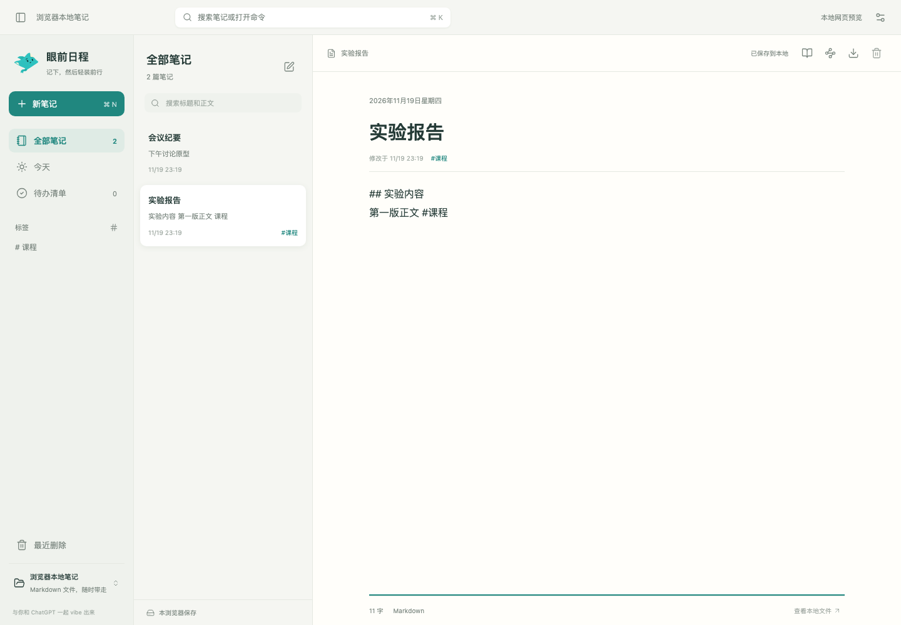

<h1 align="center">眼前日程 · Yanqian</h1>
<p align="center">记下眼前，轻装前行。</p>
<p align="center">由 <a href="https://github.com/zsanren5-arch">@zsanren5-arch</a> 和 ChatGPT 一起 vibe coding 完成。</p>

一款本地优先的 Markdown 笔记与待办电脑版。打开即可写，停笔自动保存。笔记就是你自己的 `.md` 文件，可以带走，也可以用其他编辑器打开。

[下载 macOS Apple Silicon 安装包（v1.0.0）](https://github.com/zsanren5-arch/yanqian-desktop/releases/tag/v1.0.0)

## 为什么这样做

我们用 REA 静态分析了本机 Obsidian 1.14.4 和 Notion 7.39.0 的公开客户端产物，并阅读了两者的公开用户讨论。借鉴的是本地文件、快速搜索、可选关联和正文清单混排；首页只留下真正写作需要的入口。

[REA 分析与边界](docs/research/REA-OBSIDIAN-NOTION.md) · [社交媒体与易用性调研](docs/research/SOCIAL-UX-COMPARISON.md)

Notion 的远程主编辑器不完全在本地包内，本次没有声称完整逆向；没有复制两款软件的闭源实现、读取个人笔记或发布厂商客户端。



## 现在可以做什么

- 目录、笔记列表、正文三栏，侧栏可收起；默认空本，直接输入。
- 真正的本地 Markdown 文件夹，自动保存、外部修订检测、冲突保留草稿，删除后可恢复。
- 标题、正文和标签的全文检索；快速打开与命令面板。
- Markdown 编辑/预览、正文内 `- [ ]` 待办；所有笔记的清单可集中查看，完成后可取消。
- `[[笔记名]]` 关联与反向引用，按需打开关联栏。
- 今天的日记、白天/夜晚/跟随系统，导入 Markdown 和旧版眼前 JSON 备份，导出 Markdown。
- 原创图标；关于页和本文明确标注作者与 ChatGPT 共同创作。

## 快捷键

| 操作 | macOS | Windows / Linux |
| --- | --- | --- |
| 快速打开 | ⌘ K | Ctrl K |
| 命令面板 | ⌘ P | Ctrl P |
| 新笔记 | ⌘ N | Ctrl N |
| 明确保存 | ⌘ S | Ctrl S |
| 编辑/预览 | ⌘ Shift P | Ctrl Shift P |

也可以直接点击界面按钮，不需要记住快捷键或先理解双链。

## 运行和构建

需要 Node.js 24 与 npm。Electron 是独立桌面应用；静态 HTTP 预览使用浏览器本机存储，与真正的 Markdown 文件库有明确区分。

```sh
npm ci
npm run vendor
npm start
```

macOS Apple Silicon：

```sh
npm run package:mac
```

Windows / Linux 构建配置：

```sh
npm run package:win
npm run package:linux
```

当前机器只验证 macOS arm64。Windows/Linux 提供构建配置和 CI 模板，未冒充已经做过跨平台验收。产物位于 `releases/`，不会提交到 Git 历史。

macOS 安装包目前没有 Apple Developer ID 签名和公证。请只从你信任的发布来源获取；系统拦截时可用应用的系统“打开”操作，不需要关闭 Gatekeeper 或系统安全设置。

## 数据与边界

默认在应用用户数据目录新建独立笔记库。选择文件夹后只读取 Markdown；不会自动扫描现有 Obsidian 资料库、Notion 账号、手机或旧版应用数据。应用不包含账号令牌、私有云凭据或你的笔记。

桌面版目前是独立的本地 Markdown 库，**没有自动接入旧版私有云同步、提醒通知、截图 OCR、语音听写或锁屏壁纸**。可以导入旧版备份；导入不应被理解为这些能力已经迁移。原网页/Android 版继续独立保留。当前也没有关系数据库、插件市场、附件管理或多人协作。

Markdown 正文中的原始 HTML 显示为文字，预览经过本机 DOMPurify 清理；图片语法暂显示附件说明，原文保留，不主动请求远程图片。外部 HTTP(S) 链接由系统浏览器打开。

## 验证

```sh
npm run test:host
node --test tests/model.test.mjs
node tests/browser-check.mjs
npm run test:electron
npm run check:host
```

本地目录集成测试使用临时合成文件；浏览器测试使用隔离存储和合成笔记。实际 Electron 烟测验证受限桥与真实磁盘，不能用浏览器存储冒充。

[验证记录](docs/VALIDATION.md) · [安全边界](docs/SECURITY.md) · [品牌资产说明](docs/BRAND.md)

## 开源与共同创作

本项目是 **作者 zsanren5-arch 与 ChatGPT 一起 vibe 出来的作品**。产品判断、迭代反馈与审美方向由作者提出，ChatGPT 协助调研、实现、图标探索和验证。这不是 OpenAI 官方产品。

代码采用 MIT License。第三方依赖及其许可证见 `vendor/` 与 `THIRD-PARTY-NOTICES.md`。调研摘要与原创品牌素材随仓库提供，厂商原包及完整逆向原始记录不随仓库分发。
